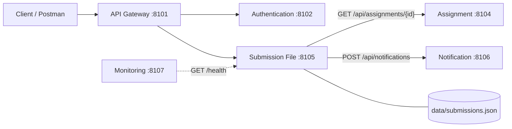
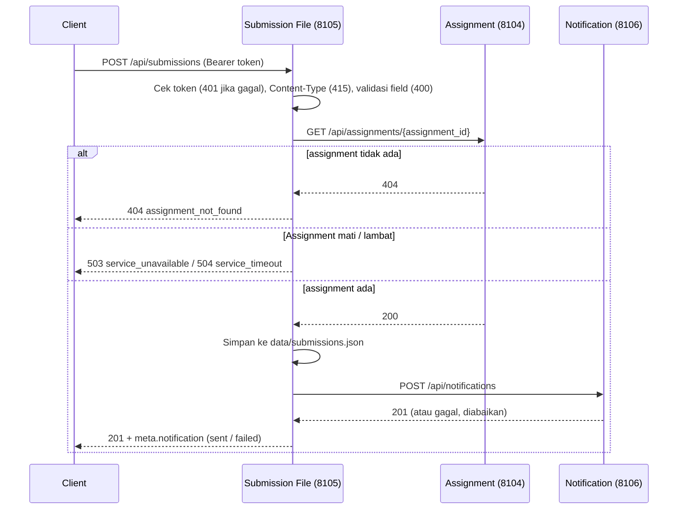

# Diagram Submission File Service (Kelompok 4)

Diagram memakai Mermaid (tampil otomatis di GitHub). Gunakan https://mermaid.live untuk mengekspornya menjadi gambar.

## Hubungan antarservice

## Alur POST /api/submissions

